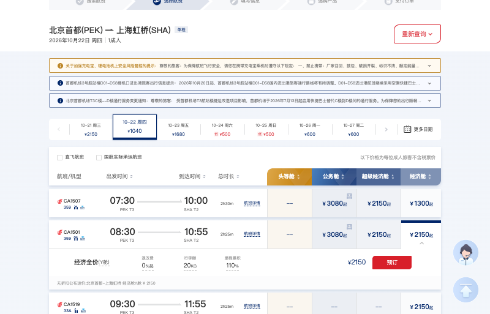

<div align="center">

# flight-fare ✈️

### 航班全价比价证据，交给 Agent 整理。

**航司官网 · 原始截图 · 可追溯记录**

[](https://github.com/anyang1991/flight-fare/actions/workflows/validate.yml)

给支持浏览器操作的 AI agent 使用的 [Agent Skill](https://agentskills.io/specification)：查询航司官网的全价经济舱产品，核对页面明示的舱位与价格，保存原始截图和查询记录，辅助报销比价材料准备。

**[安装使用](#安装)** · [输入与输出](#使用) · [覆盖与实测](#覆盖与实测状态) · [反馈问题](https://github.com/anyang1991/flight-fare/issues)

</div>



上图来自仓库保存的历史查询：航班号、完整日期、航段、产品名称与价格同屏可读。交付的是浏览器原始渲染截图；图中报价仅记录当次查询。

**需要能操作网页并保存截图的浏览器工具。** skill 提供查询流程与站点经验，不包含浏览器本身；宿主需另行提供浏览器能力（见[安装](#安装)）。

## 它做什么

- 按航班号、日期、航段在目标航司官网查询经济舱报价，展开明细找到全价经济舱产品。
- 保留官网原始产品名称与舱位代码；只认页面明示的“经济全价 / 全价经济舱 / Y 舱”证据，不按折扣倒算。
- 保存浏览器原始渲染截图，一屏放不下时保存同一次查询的多张截图，并生成结构化 `汇总.md`。
- 每次查询都输出 `经验复盘.md`，记录真实踩坑、有效修正、省 Token 做法和下次最短路径；成功、失败和需接续的任务均保留。
- 支持 `MU5137`、`3U8886`、`8L…`、`9C…`、`G5…` 等含数字的航司代码，兼容 `mu 5137` 这类空格和小写输入。
- 内置 24 个航司官网入口及站点经验，含两轮真实实测记录（见[覆盖与实测状态](#覆盖与实测状态)）。

## 边界

- **只查询，不下单。** 不填写旅客信息、不创建订单、不支付；验证码或登录由用户在官方页面完成。
- **不改证据。** 不修改页面文字、价格、日期、DOM/CSS，不隐藏航班行，不拼图或合成截图。
- **不绕过限制。** 不绕过验证码、登录或风控；登录墙航司由用户在官方页面登录后接续查询。
- **不保证报销通过。** 截图取自官网不等于财务必然接受，是否适用由用户所在单位的报销要求决定。
- **不越界推断。** 未来报价不能证明过去价格；未指定日期时最多顺延 14 天并标注“替代日期参考”；无法确认全价时如实标注，不用第三方价格、其他日期或其他航司替代。
- **失败如实记录。** 查询失败、证据不完整、需用户操作的项目都写入汇总，不遗漏。

## 适合谁

- 需要留存官网全价舱价格截图用于报销比价的个人用户。
- 需要可追溯、可复核价格证据的财务或审计人员。
- 希望给 AI agent 配备标准化取证流程的开发者与技能维护者。

## 安装

安装目录名保持 `flight-fullfare-screenshot`，与 `SKILL.md` 中的 `name` 一致。已有目录请先检查本地修改，不要直接覆盖。

### 1. 安装 skill

**Codex（个人使用）**

macOS / Linux：

```sh
mkdir -p ~/.agents/skills
git clone https://github.com/anyang1991/flight-fare.git ~/.agents/skills/flight-fullfare-screenshot
```

Windows PowerShell：

```powershell
New-Item -ItemType Directory -Force -Path "$HOME/.agents/skills" | Out-Null
git clone https://github.com/anyang1991/flight-fare.git "$HOME/.agents/skills/flight-fullfare-screenshot"
```

目录依据 [OpenAI 官方本地 skill 文档](https://learn.chatgpt.com/docs/build-skills#where-codex-loads-local-skills)。也可以让 Codex 自带的 skill-installer 从本仓库安装。安装后在技能列表中检查；未出现时重启宿主。

**Claude Code**

```sh
mkdir -p ~/.claude/skills
git clone https://github.com/anyang1991/flight-fare.git ~/.claude/skills/flight-fullfare-screenshot
```

Windows PowerShell 将目标改为 `"$HOME/.claude/skills/flight-fullfare-screenshot"`。

**其他 agent**

将仓库放入该工具文档规定的 skills 目录，保留根目录 `SKILL.md` 和 `references/`。不支持 skills 的工具可以显式读取这两个文件。遵守各宿主的工具限制，不需要固定的 proxy、端口或浏览器配置。

### 2. 安装浏览器工具（必装其一）

skill 只提供流程与站点经验，浏览器能力由宿主提供。三种方案任选其一：

**方案 A：web-access（ZCode 生态；CDP 直连日常浏览器，天然携带登录态）**

```sh
git clone https://github.com/eze-is/web-access.git ~/.zcode/skills/web-access
node ~/.zcode/skills/web-access/scripts/check-deps.mjs
```

前置：Node.js 22+、本机装有 Chrome 或 Edge。`check-deps` 退出码：`0` 就绪；`2` 未确定默认浏览器，把 `chrome` 或 `edge` 写入 `~/.zcode/skills/web-access/config.env` 的 `WEB_ACCESS_BROWSER=` 后重跑；`1` 按 stdout 提示操作后重跑。

**方案 B：Playwright MCP（Claude Code 等）**

```sh
claude mcp add playwright -- npx @playwright/mcp@latest
```

**方案 C：chrome-devtools MCP（Claude Code 等）**

```sh
claude mcp add chrome-devtools -- npx chrome-devtools-mcp@latest
```

方案 A 用 `curl http://localhost:3456/targets` 确认 proxy；方案 B/C 在 agent 会话中确认 MCP 工具已挂载。

### 3. 验证

对 agent 说「查 MU5137 的全价经济舱截图」，确认能返回截图、汇总和经验复盘。

### 代理环境注意（装不上时先看这里）

- `git clone` / `git push` 长时间无响应，或报 `HTTP2 framing layer` / `Failed to connect to github.com port 443` → 先检查网络和已有代理配置。使用本地代理时，确认进程与端口可用（如 `nc -z 127.0.0.1 7890`），再按实际端口配置仓库代理，例如 `git config http.proxy http://127.0.0.1:7890`。
- `curl` 下载 zip 返回 200 但解压报错 → 下载被静默截断，解压前务必 `unzip -t` 校验完整性。

## 使用

### 输入

下面的历史查询示例展示输入格式；实际使用时替换为你要查询的出行日期。

```text
帮我查 CA1501，2026-10-22，北京首都到上海虹桥的全价经济舱价格，报销用，要官网截图。
```

```text
查 MU5137、HU7605 的全价经济舱，未指定日期时用最近可查日期，并注明替代日期。
```

航班号支持含数字的航司代码（`3U`、`8L`、`9C`、`G5` 等）、空格和小写。无法从官网确定航线时会询问，不会猜航线。

### 输出

默认写入当前任务的 `报销截图/查询_YYYYMMDD_HHMMSS/`（或用户/宿主指定的交付目录），重复运行不覆盖旧记录：

```text
CA1501_20261022_PEK-SHA_全价经济舱_01.png
CA1501_20261022_PEK-SHA_全价经济舱_02.png
汇总.md
经验复盘.md
```

`汇总.md` 包含成功与失败项、航班/承运人、请求及实际查询日期、机场、产品原文、价格/币种/税费口径、官网链接、带时区采集时间和截图链接。

`经验复盘.md` 与汇总互链，记录本次环境、实际问题、定位依据、修正结果、省 Token 做法及后续维护建议；没有新坑时明确写“本次无新增经验”，不编造失败或节省量。文件写入不可用时直接在回复中输出复盘。详细格式见 [复盘与改进闭环](references/run-retrospective.md)，具体操作经验整合在[对应航司条目](references/airlines.md)中。复盘默认保存在本次交付目录，不自动改写已安装技能或提交到公共仓库。

## 证据与查询规则

- **指定日期就查指定日期。** 没有日期时，从出发地今天起最多查 14 个日期，并标“替代日期参考”。未来报价不能证明过去价格。
- **不假设全价在不同日期、航司、机场间一致。** 国航[国内运价规则](https://webresource.airchina.com.cn/zh-CN/content/c/2026-04-20/28994.shtml)要求以销售系统计算的价格为准；本工具只记录本次页面展示。
- **有明确证据才确认全价。** “¥…起”、最高档、升级产品或按折扣倒算都不算。只显示“经济舱全价”时不自行补写 Y 舱；税费未标注时明确记录。
- **保留原始页面。** 不修改价格、日期、DOM/CSS，不隐藏航班行、不拼图；同屏放不下就交付同次查询的多张截图。完整年份、航班、航段和产品价格均须可核对。
- **可追溯。** 每次查询独立建目录，汇总含带时区采集时间与官网链接；URL 含敏感参数时脱敏并注明“复查需重新查询”。

## 覆盖与实测状态

[航司入口表](references/airlines.md)收录 24 个航司代码。同日完成**两轮独立实测**（第一轮 Windows+Playwright 独立浏览器；第二轮 macOS+web-access CDP 日常浏览器），两轮结论可交叉印证。最新一轮（第二轮深夜复测）结果：

| 本轮证据 | 航司 |
|---|---|
| 明确全价产品（11 家） | MU ¥2150 / FM ¥1490 / CA ¥2150 / CZ ¥3060 / HU ¥4190 / GS ¥2170 / 8L ¥3380 / PN ¥2180 / SC ¥1437（带“已减3元”）/ 3U ¥2950 / UQ ¥2810 |
| 未确认全价（6 家） | KN（仅航段公布价 ¥1630）/ ZH（经济舱 ¥3650，无全价标签）/ MF（Y ¥3090，12 舱位无全价标注）/ HO（公布价 ¥1790 与 Y 售价 ¥1785 双口径）/ 9C（公布价 ¥2350，LCC）/ EU（Y ¥2450，无全价字样） |
| 受阻（7 家） | TV（城市面板对 CDP 鼠标事件不响应，需 Playwright 类原生点击，上轮可查）/ JD（官网 403，海航航班动态校验异常）/ G5、GJ、BK、DZ（登录墙/会话强制）/ KY（查询已通但 KMG→PEK 无该司航班） |

逐家详情、原始截图与两轮对比（4 家升级、7 家结论复现一致）见 [第二轮复测报告](references/live-tests-retest-20261021.md) 与 [第一轮实测报告](references/live-tests-20261021.md)。

### 需要登录接续的航司

以下航司的票价查询**强制要求账号会话**，匿名查询取不到全价证据（两轮实测均复现）。接续办法统一：

> 你在宿主浏览器的**官方登录页**完成登录（不注册新账号、不向 agent 提供密码/验证码），然后对 agent 说「继续查 XX」；agent 会复用已登录会话重新执行原查询，并按同一套证据规则截图取证。

| 航司 | 受阻位置 | 登录入口（官方页面） |
|---|---|---|
| G5 华夏航空 | 提交查询后跳转 `/b2cweb/login` | chinaexpressair.com 官网登录入口 |
| GJ 长龙航空 | 点「查询预订」后跳 `#/login` | loongair.cn 首页登录入口 |
| BK 奥凯航空 | 点「立即查询」后跳会员账号登录页 | okair.net 会员登录入口 |
| DZ 东海航空 | 订票页弹「会话已过期，请重新登录」（手填航线直连入口也复现） | donghaiair.com 登录入口 |

另有两类**非登录**受阻：TV 西藏航空需 Playwright 类原生点击工具（web-access CDP 鼠标事件对其城市候选无效，第一轮已用 Playwright 查通）；JD 首都航空官网 403 且海航「航班动态」校验异常。原因与现场截图均记录在复测报告中。

这是一组航线和日期的真实浏览器抽查，不代表 24 家全部支持、所有航线可用或当前报价可跨日期复用。官网改版、风控、需登录、未开售、售罄、共享航班或无标准全价产品都可能影响查询。

## 历史示例

以下是原仓库留存的截图，**不是本次新查询结果，也不应当作当前报价或其他日期的报销凭证**。部分截图没有显示完整年份，原版流程曾允许改动页面布局，未保存可审计的原始页面记录；新流程要求不改页面并补齐证据。

| 航班 | 文件所标日期 | 原图 | 局限 |
|---|---|---|---|
| CA1501 | 2026-10-22 | [查看](examples/CA1501_20261022_全价经济舱.png) | 历史结果，不能推定其他日期价格 |
| MU5137 | 2026-10-22 | [查看](examples/MU5137_20261022_全价经济舱.png) | 显示全价产品，未直接展示 Y 代码 |
| CZ3099 | 2026-10-22 | [查看](examples/CZ3099_20261022_全价经济舱.png) | 图片未显示完整年份 |
| HU7605 | 2026-10-22 | [查看](examples/HU7605_20261022_全价经济舱.png) | 图片未显示完整年份 |

## 开发与贡献

查询使用本身不需要 Python。维护者可用 Python 3.10+ 运行离线检查：

```sh
python -m pip install -r requirements-dev.txt
python scripts/validate.py
python -m unittest discover -s tests -v
```

CI 在 Windows 和 Linux 检查技能元数据、安装包目录名、相对链接和测试。离线检查不访问航司，也不能证明价格查询成功。

提交站点经验时附测试日期、入口、航司/航段、浏览器环境、实际结果和已脱敏的原始截图；区分“入口可访问”和“全价截图已成功”。先报告或提交修改，不让普通查询自动改写已安装文件。不要提交个人行程、账户信息、cookie 或未经审查的日常查询输出；公开测试示例仅保留自选行程和已核对的公开页面证据。

许可证：[MIT](LICENSE)。代码和文档允许复用、修改和分发；示例中的航司标识、网页内容等第三方材料不因此获得额外授权。
