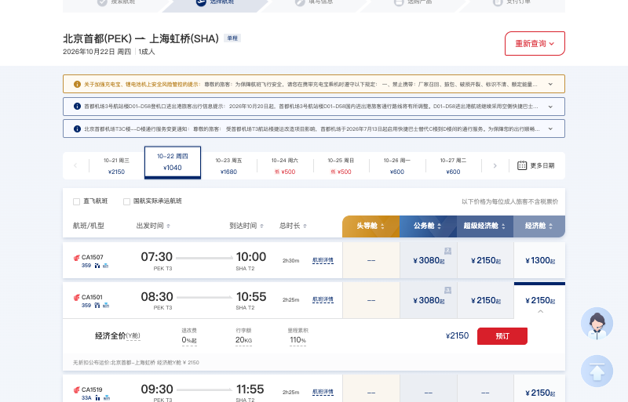
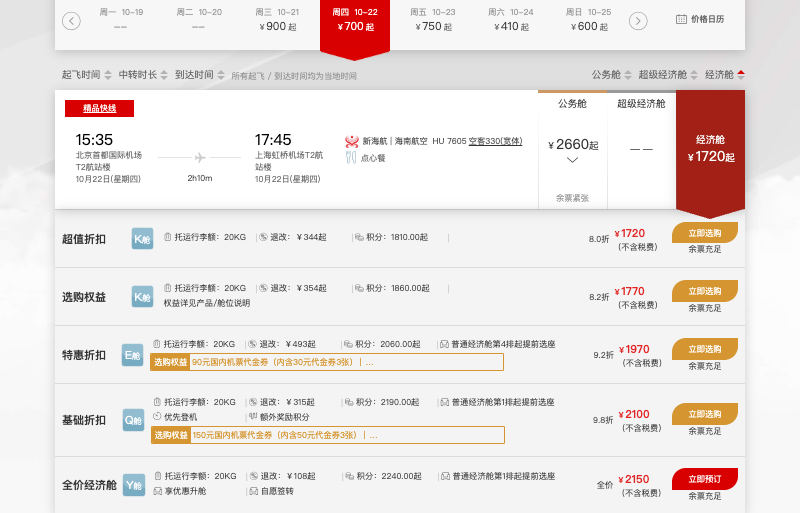

# flight-fare ✈️

> **通用 Agent Skill**:输入航班号,agent 自动在航空公司官网查询全价经济舱(Y 舱)价格,并截取可直接用于报销的凭证截图。
> 遵循 [Agent Skills](https://agentskills.io) 规范(SKILL.md 格式),ZCode、Claude Code 及任何能驱动浏览器的 agent 都能用。

## 为什么需要它

差旅报销时,公司通常要求提供**航空公司官网**的全价经济舱(Y 舱)价格截图作为报销标准凭证。手动流程很痛苦:打开官网 → 猜航线 → 选日期 → 翻航班列表 → 展开舱位明细 → 找到 Y 舱全价 → 调整画面截图——每个航班都要来一遍。

两个关键事实让这件事可以完全自动化:

1. **Y 舱是民航公布运价,只与航线有关,不随购票日期浮动。** 所以不需要指定日期,查最近一个可查的执飞日期即可。
2. **列表页显示的永远是最低折扣价**,全价藏在点击经济舱价格格之后的舱位明细里。各家官网入口、展开方式、弹窗陷阱各不相同——这些经验已经沉淀在本 skill 的站点经验库里,越用越准。

## 功能

- 🎯 输入一个或多个**航班号**(如 `MU5137 CA1501`),无需日期、无需航线
- 🏢 自动按二字码路由到对应**航司官网**(国航 / 东航 / 南航 / 海航等 20+ 家已收录)
- 📅 自动从今天起顺延,找到该航班最近的可查执飞日期(非每日航班自动跳过不执飞日)
- 💰 自动展开舱位明细,定位**全价经济舱(Y 舱)**档位
- 📸 生成合规截图:**航班号、日期、航段、全价价格同屏可见**
- 📊 批量查询后输出 `报销截图/汇总.md` 汇总表

## 实测效果

| 航班 | 航段 | 查询日期 | 全价经济舱(Y舱) | 截图 |
|------|------|----------|------------------|------|
| CA1501(国航) | 北京首都 → 上海虹桥 | 2026-10-22 | ¥2150 | [查看](examples/CA1501_20261022_全价经济舱.png) |
| MU5137(东航) | 上海虹桥 → 北京大兴 | 2026-10-22 | ¥2150 | [查看](examples/MU5137_20261022_全价经济舱.png) |
| CZ3099(南航) | 广州白云 → 北京大兴 | 2026-10-22 | ¥3060 | [查看](examples/CZ3099_20261022_全价经济舱.png) |
| HU7605(海航) | 北京首都 → 上海虹桥 | 2026-10-22 | ¥2150 | [查看](examples/HU7605_20261022_全价经济舱.png) |

 

> 同一航线(北京—上海)国航/东航/海航 Y 舱均为 ¥2150——公布运价全航司一致,这正好印证了"无需指定日期"的设计;不同航线价差很大(广州—北京为 ¥3060),截图按航线对应留存即可。

## 安装(本节写给 agent:逐步执行即可完成全部环境搭建)

### 第 1 步:安装 skill 本体

```bash
# ZCode
git clone https://github.com/anyang1991/flight-fare.git ~/.agents/skills/flight-fullfare-screenshot

# Claude Code
git clone https://github.com/anyang1991/flight-fare.git ~/.claude/skills/flight-fullfare-screenshot

# 其他遵循 Agent Skills 规范的工具:clone 到该工具的 skills 目录,保持 SKILL.md 在目录根
# 不支持 skills 机制的 agent:把 SKILL.md 与 references/airlines.md 作为系统提示/知识注入即可
```

克隆后重启 agent(或新开会话)即可被自动发现。

### 第 2 步:安装浏览器自动化能力(三选一)

**方案 A:ZCode + web-access(推荐;CDP 直连日常浏览器,天然携带登录态)**

```bash
# 1. 克隆 web-access skill
git clone https://github.com/eze-is/web-access.git ~/.zcode/skills/web-access

# 2. 环境自检(前置:Node.js 22+、本机装有 Chrome 或 Edge)
node ~/.zcode/skills/web-access/scripts/check-deps.mjs
```

按 check-deps 的退出码处理:
- `exit 0` → 就绪,可直接按 SKILL.md 执行任务;
- `exit 2` → 未确定默认浏览器:把 `chrome` 或 `edge` 写入 `~/.zcode/skills/web-access/config.env` 的 `WEB_ACCESS_BROWSER=`,然后重跑;
- `exit 1` → 按 stdout 提示操作后重跑(通常是先手动打开一次浏览器即可自动解决)。

**方案 B:Playwright MCP(Claude Code 等)**

```bash
claude mcp add playwright -- npx @playwright/mcp@latest
```

**方案 C:chrome-devtools MCP(Claude Code 等)**

```bash
claude mcp add chrome-devtools -- npx chrome-devtools-mcp@latest
```

> 三种方案对 SKILL.md 里的流程和站点经验完全等价。选 A 用 `curl http://localhost:3456/targets` 确认 proxy 就绪;选 B/C 在 agent 里确认 MCP 工具已挂载。
> 全部就绪后,对 agent 说一句「查 MU5137 的全价经济舱截图」即可端到端验证。

## 用法

对 agent 直接说,例如:

```
帮我查 MU5137 和 CA1501 的全价经济舱价格,报销用,要截图
```

```
查一下 CZ3099、HU7605、3U8886 的全价经济舱,截图存一下
```

Skill 会自动完成全部流程,最后输出类似:

| 航班号 | 航段 | 查询日期 | 全价经济舱(Y舱) | 截图 |
|--------|------|----------|------------------|------|
| MU5137 | SHA→PKX | 2026-10-22 | ¥2150 | 报销截图/MU5137_20261022_全价经济舱.png |

截图统一保存在当前工作目录的 `报销截图/` 下,并附 `汇总.md`。

## 工作原理

```
航班号列表
   │
   ├─ 1. 二字码 → 航司官网(references/airlines.md 速查表)
   ├─ 2. 航线解析(用户附带 / 官网航班动态 / 城市级搜索验证)
   ├─ 3. 浏览器自动化打开官网,GUI 填表查询(城市级,覆盖全部机场)
   ├─ 4. 从今天起顺延,锁定最近的可查执飞日期
   ├─ 5. 点击经济舱价格格,展开舱位明细,定位"全价/Y舱"档
   ├─ 6. 构图确保 航班号+日期+航段+全价 同屏,截图
   └─ 7. 保存 报销截图/{航班号}_{日期}_全价经济舱.png + 汇总.md
```

设计原则(详见 [SKILL.md](SKILL.md)):

- 只在**航空公司官网**取证,绝不使用携程/去哪儿等第三方平台价格替代
- 绝不点击"预订/支付",不填写任何旅客信息,不产生订单
- 与具体 agent/工具解耦:流程和站点经验是通用的,浏览器操作换成你手头任何工具都成立
- 每家官网的入口 URL、舱位展开方式、弹窗陷阱持续沉淀到 `references/airlines.md`,只记录实际验证过的事实

## 已验证航司

| 航司 | 官网 | 状态 |
|------|------|------|
| 中国国航 CA | airchina.com.cn | ✅ 实测通过 |
| 中国东航 MU / 上航 FM | ceair.com | ✅ 实测通过 |
| 中国南航 CZ | b2c.csair.com | ✅ 实测通过 |
| 海南航空 HU 及海航系(GS/8L/PN/UQ) | new.hnair.com | ✅ 实测通过 |

其余 20+ 家航司(深圳航、山东航、厦航、吉祥、春秋、川航、华夏等)已收录官网入口,可按 SKILL.md 的通用流程查询;欢迎按同样的格式把新验证的经验提交回来。

## 已知边界

- 海航门户 `www.hnair.com` 在部分网络环境(挂代理时)会被 WAF 拒绝(403),skill 已改为直达订票子域 `new.hnair.com` 绕开;若仍不通,请为 `hnair.com` 配置代理直连规则。
- 国航官网当天日期禁选(当天预订有截止时间),skill 会自动顺延;目标航班为当天早班机已起飞时,同样顺延到次日。
- 春秋(9C)等廉航可能没有标准 Y 舱全价票,skill 会如实说明而不是硬给。
- 共享航班(实际承运与航班号航司不同)按航班号所属航司官网查询。

## 目录结构

```
flight-fare/
├── README.md            # 本文件
├── SKILL.md             # skill 主逻辑(触发条件、流程、兜底策略)
├── references/
│   └── airlines.md      # 航司速查表 + 各官网已验证的站点经验(持续更新)
└── examples/            # 真实查询产出的示例截图
```
